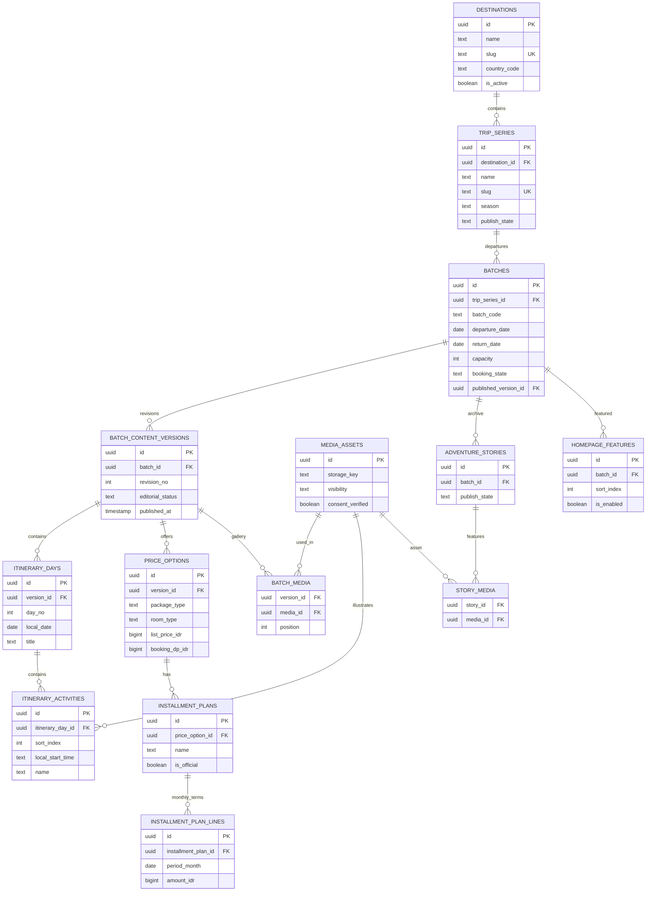
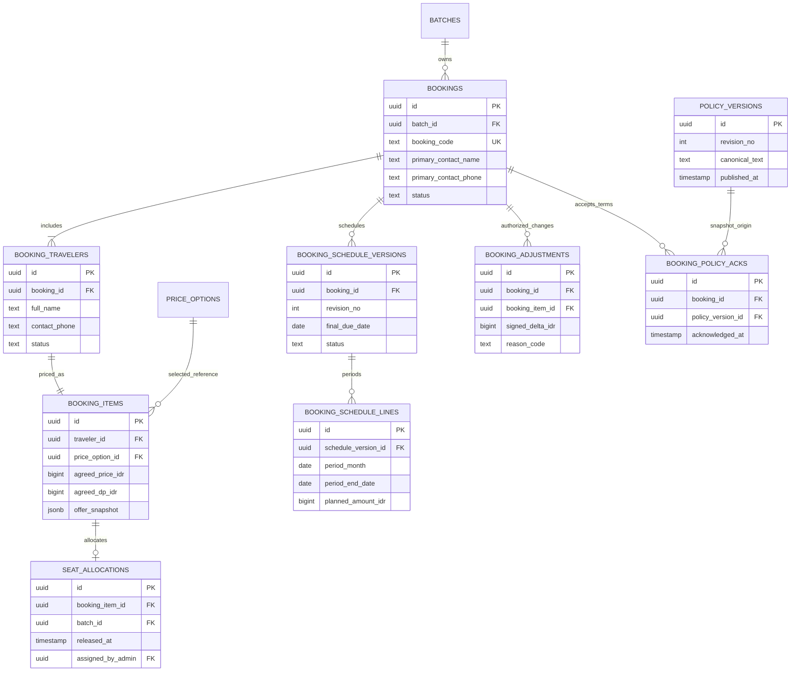
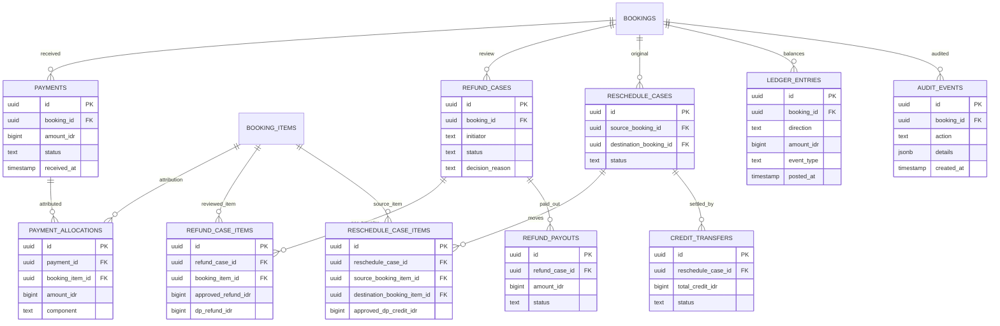

# VACAY WITH STRANGERS — ENTITY RELATIONSHIP DESIGN

**Document:** VWS-ERD-001  
**Version:** 1.0 — logical/physical database blueprint aligned with `VWS_PRD_v1.0.md`  
**Date:** 15 October 2026  
**Target:** PostgreSQL; ORM/provider can be selected during Antigravity architecture gate.

> **Design contract:** all money in integer IDR minor units (for IDR, integer rupiah); no floating-point balances. All customer-visible prices, booking totals and published itinerary data have explicitly governed versions. Strong foreign keys, authenticated server-side mutations, auditable finance, manual seat decisions. This is an implementation blueprint, **not a claim that migrations have run**.

---

## 1. Design principles and boundary decisions

1. **Single Admin** is an application rule (`one active owner`) with external-auth identity or securely managed password/passkey. It must not mean unauthenticated admin APIs.
2. One `destination` can have many `trip_series`; one series many `batches`. Each batch has **versioned published content** and operational availability.
3. Each **batch** can publish many `price_options`, including Full and Land Only, optional room variants and date-bound promotions, without creating duplicate series.
4. Group booking = one `booking` with one primary contact and multiple `booking_travelers`; each traveler has an individual `booking_item` for price, DP and seat attribution.
5. **One booking belongs to one batch.** A partial reschedule creates a linked booking for only the moved traveler(s) on the new batch. Prevents a single invoice from spanning different departure dates/H-30 rules.
6. Manual allocation is represented explicitly, not derived from WhatsApp clicks or booking `pending` status. A seat allocation belongs to a booked traveler/item; multiple tabs cannot double-allocate.
7. Inbound payments, refunds and inter-booking credits are different event types with documentary and approval references. An **append-only booking balance ledger** is authoritative for reconciliation.
8. Published itineraries and offers are immutable by revision; bookings also snapshot negotiated commercial values. Public content changes do not rewrite historic booked values.
9. No public traveler identity directory. Personal/financial data is admin-only. Images of real travelers need publication permission.
10. Unapproved business policy cannot be guessed from marketing posters. Defaults identified below are **provisional**, not independently authorized terms.

### Shared conventions

- IDs: UUID PK (prefer UUIDv7 or random UUID supported by selected database/driver).
- Monetary amount: `BIGINT` `*_idr` and `CHECK(amount >= 0)` where negative amounts are not meaningful; signed adjustments use `signed_delta_idr` with clear semantics.
- Timestamps: `TIMESTAMPTZ` in UTC. Travel/business `DATE` plus IANA timezone (`Asia/Jakarta` policy; local on-site activities in actual venue timezone, e.g. `Asia/Tokyo`).
- User-facing slugs: `CITEXT` or normalized lowercase with unique index, stable after publication or redirect on change.
- Auditing: `created_at`, `updated_at` on mutable entities; immutable event timestamps on ledger/audit entries; a soft archive flag rather than deleting referenced commercial data.
- Enums can be PostgreSQL enums or `TEXT CHECK` with deliberate migration/version control, not freeform UI strings.
- `NOT NULL`, `UNIQUE`, FK actions and DB transactions are mandatory for critical invariants.

## 2. ER diagram — Travel catalog, versioning, editorial



**Diagram note:** Mermaid ER cannot reliably show the published version FK from `BATCHES` back to the same batch's `BATCH_CONTENT_VERSIONS` with a composite guard; enforce that relation in SQL transaction/application service and checks described below. Canonical fields are in the dictionary, not just the diagram.

## 3. ER diagram — Booking and seat allocation



`BOOKING_TRAVELERS → BOOKING_ITEMS` is 1:1 **within a particular booking**. On a partial reschedule, create a new booking and a new item/traveler record linked by reschedule case, preserving old item rather than repointing the historical item to another batch. Group traveler IDs are not global customer accounts.

## 4. ER diagram — Cash, refunds, credits, audit



Additional references not shown in diagrams for legibility: `ADMIN_USERS → audit actor / seat allocator / payment verifier / refund reviewer / publisher`; `PAYMENT_ALLOCATIONS → BOOKING_SCHEDULE_LINES` optional; `MEDIA_ASSETS → payment proof / refund proof` private; `RESCHEDULE_CASES.destination_booking_id → BOOKINGS`; `CREDIT_TRANSFERS` has `source_booking_id`, `destination_booking_id` and attributed traveler/item links.

## 5. Complete entity dictionary

**P0 core tables (26+ tables split by domain; names may be normalized consistently during migrations, but semantics cannot be removed):**

### 5.1 Authentication, catalog and editorial

| Table | PK and important columns | Constraints / meaning |
|---|---|---|
| `admin_users` | `id`, `auth_subject_id`, `email`, `is_active`, `created_at` | One **active** administrator enforced by unique partial index on a single `role='owner'` or one-row config; provider sessions separate |
| `destinations` | `id`, `name`, `slug`, `country_code`, `summary`, `is_active`, `sort_index` | Unique slug; no fictitious destination publication |
| `trip_series` | `id`, `destination_id`, `name`, `slug`, `season`, `description`, `publish_state` | FK destination; unique slug globally; season optional |
| `batches` | `id`, `trip_series_id`, `batch_code`, `slug`, `departure_date`, `return_date`, `departure_timezone`, `capacity`, `booking_state`, `published_version_id`, `show_exact_seats`, `limited_seats_threshold` | Unique `(trip_series_id,batch_code,year?)` implemented as stable unique batch slug; dates ordered; capacity >=0; no unsourced status; published_version belongs to same batch |
| `batch_content_versions` | `id`, `batch_id`, `revision_no`, `status`, `hero_media_id`, `title`, `lead`, `route_summary`, `departure_meeting_info`, `published_at`, `created_by_admin` | Unique `(batch_id, revision_no)`; only one draft at a time under V1 editor; immutable after publication; published pointer switches atomically |
| `itinerary_days` | `id`, `version_id`, `day_no`, `local_date`, `title`, `description`, `highlight_media_id` | Unique `(version_id, day_no)`; aligned with batch duration and date when published |
| `itinerary_activities` | `id`, `itinerary_day_id`, `sort_index`, `start_local_time`, `end_local_time`, `activity_type`, `title`, `details`, `location_name`, `location_lat`, `location_lng`, `is_optional`, `media_id`, `local_timezone` | Unique `(itinerary_day_id, sort_index)`; times optional; end after start when same day; none invented |
| `price_options` | `id`, `version_id`, `sku`, `display_name`, `package_type`, `room_type`, `list_price_idr`, `promo_price_idr`, `promo_start_at`, `promo_end_at`, `dp_per_traveler_idr`, `included_json`, `excluded_json`, `land_meeting_info`, `is_enabled` | Unique `(version_id, sku)`; >0 price; promo lower than list when active; promo date valid; Full/Land clear; published revision rows immutable |
| `installment_plans` | `id`, `price_option_id`, `name`, `is_official`, `booking_window_start`, `booking_window_end`, `dp_idr`, `terms_notes`, `is_enabled` | Only official plans stored here; custom proposal is *not* an approved published plan |
| `installment_plan_lines` | `id`, `plan_id`, `period_month`, `amount_idr`, `sort_index` | Month is first-of-month `DATE`; unique plan/period; published schedule sum + DP matches offer price where plan applies |
| `media_assets` | `id`, `storage_key`, `mime_type`, `width`, `height`, `alt_text`, `attribution`, `visibility`, `consent_verified`, `consent_reference`, `uploaded_by_admin` | Storage URLs not permanent DB truth; secure private content; verify publication rights |
| `batch_media` | `id`, `version_id`, `media_id`, `sort_index`, `usage` | FK version, media; unique order per usage |
| `adventure_stories` | `id`, `batch_id`, `headline`, `story_text`, `credited_name`, `consent_status`, `publish_state`, `published_at` | Only actual completed trip/consented quote published |
| `story_media` | `id`, `story_id`, `media_id`, `sort_index` | FK; rights and visibility checked at publication |
| `homepage_features` | `id`, `batch_id`, `sort_index`, `is_enabled`, `style_variant`, `caption_override` | Feature only actually published batch or safe brand-story fallback |
| `site_settings` | `key` PK, `value_json`, `updated_by_admin`, `updated_at` | Whitelisted keys (WA number, public header, etc.), no arbitrary script injection |
| `policy_versions` | `id`, `revision_no`, `policy_type`, `canonical_text`, `published_at`, `published_by_admin` | Immutable published policy; historical reference for booking |

### 5.2 Booking and scheduled obligations

| Table | PK and important columns | Constraints / meaning |
|---|---|---|
| `bookings` | `id`, `batch_id`, `booking_code`, `primary_contact_name`, `primary_contact_phone`, `primary_contact_email`, `status`, `source`, `notes_private`, `confirmed_at`, `created_by_admin` | One batch per booking; booking code unique; contact validated; **no public insert** |
| `booking_travelers` | `id`, `booking_id`, `full_name`, `contact_phone`, `status`, `notes_private` | A row per traveler even within one group; minimize identity data |
| `booking_items` | `id`, `booking_id`, `booking_traveler_id`, `price_option_id`, `offer_snapshot_json`, `agreed_price_idr`, `agreed_dp_idr`, `effective_policy_version_id`, `status`, `agreed_at` | Unique `(booking_id, booking_traveler_id)`; price_option historical reference; always belongs to same original batch through booked revision; never mutate agreed price, use adjustments |
| `seat_allocations` | `id`, `batch_id`, `booking_item_id`, `assigned_at`, `assigned_by_admin`, `released_at`, `released_by_admin`, `reason` | At most one *active* seat allocation per booking_item; one allocated seat per traveler; live count only rows with `released_at IS NULL`; locked transaction capacity check |
| `booking_schedule_versions` | `id`, `booking_id`, `revision_no`, `status`, `final_due_date`, `dp_total_idr`, `agreed_terms_snapshot`, `approved_by_admin`, `created_at` | Unique booking/revision; only one active schedule; old schedules retained for audit |
| `booking_schedule_lines` | `id`, `schedule_version_id`, `period_month`, `period_end_date`, `planned_amount_idr`, `sort_index` | Unique `(schedule_version_id, period_month)`; period_end_date = min(month end,H-30) unless documented legal exception; exact monthly obligations |
| `booking_adjustments` | `id`, `booking_id`, `booking_item_id` nullable, `signed_delta_idr`, `adjustment_type`, `reason_text`, `approved_by_admin`, `created_at` | + increases contractual charge; - reduces charge (e.g. authorized cancellation/repricing); append-only after posting |
| `booking_policy_acks` | `id`, `booking_id`, `policy_version_id`, `acknowledged_at`, `method`, `evidence_reference` | Capture actual agreement/confirmation; do not claim acceptance without evidence |

### 5.3 Inbound money, allocation, decisions, double-count prevention

| Table | PK and important columns | Constraints / meaning |
|---|---|---|
| `payments` | `id`, `booking_id`, `amount_idr`, `status`, `payment_channel`, `external_reference`, `received_at`, `verified_at`, `verified_by_admin`, `proof_media_id` | Unique verified bank reference *where usable*; positive amount; never delete a verified receipt |
| `payment_allocations` | `id`, `payment_id`, `booking_item_id`, `schedule_line_id` nullable, `component` (`dp`, `installment`, `other`), `amount_idr` | Sum allocations <= payment amount; same booking; allocation per traveler permits partial cancellation accounting |
| `refund_cases` | `id`, `booking_id`, `initiated_by` (`participant`/`organizer`), `reason`, `status`, `requested_at`, `decision_at`, `decision_by_admin`, `decision_notes` | Manual review; participant DP non-refundable by default, but organizer/lawful exceptions separate |
| `refund_case_items` | `id`, `refund_case_id`, `booking_item_id`, `paid_dp_attributable_idr`, `approved_refund_idr`, `approved_dp_refund_idr`, `decision_notes` | One item per affected traveler; non-DP vs DP amounts shown distinctly; approved cannot exceed legally/contractually available funds |
| `refund_payouts` | `id`, `refund_case_id`, `amount_idr`, `status`, `paid_at`, `transfer_reference`, `proof_media_id`, `entered_by_admin` | Partial payouts allowed; sum verified paid <= approved amount, except a documented legal correction workflow |
| `reschedule_cases` | `id`, `source_booking_id`, `destination_booking_id`, `source_batch_id`, `destination_batch_id`, `status`, `reason`, `approved_by_admin`, `approved_at` | Destination booking generated only after explicit admin decision; source and target bookings must be on different batches; preserve both |
| `reschedule_case_items` | `id`, `reschedule_case_id`, `source_booking_item_id`, `destination_booking_item_id`, `dp_credit_decision`, `approved_dp_credit_idr`, `approved_other_credit_idr`, `decision_notes` | Pair moved travelers; DP transferred only by explicit case decision; credits <= eligible verified funds |
| `credit_transfers` | `id`, `reschedule_case_id`, `source_booking_id`, `destination_booking_id`, `source_booking_item_id`, `destination_booking_item_id`, `dp_component_idr`, `other_component_idr`, `status`, `applied_at`, `approved_by_admin` | Internal money movement, **not a new receipt**; identical transfer ID drives outbound/inbound ledger entries atomically |
| `ledger_entries` | `id`, `booking_id`, `booking_item_id` nullable, `direction` (`debit`/`credit`), `amount_idr`, `event_type`, `source_kind`, `source_id`, `reversal_of_entry_id`, `posted_at`, `posted_by` | **Append only**; posted only for confirmed charge, verified payment, authorized adjustment, applied transfer or completed refund; source idempotency unique; compensating reversal, no UPDATE/DELETE |
| `audit_events` | `id`, `admin_user_id`, `entity_type`, `entity_id`, `booking_id` nullable, `event_type`, `before_json`, `after_json`, `reason`, `created_at`, `request_id` | Append-only, redacted fields where necessary; do not place passport/bank secrets in audit log |

> `refund_case_items`, `reschedule_case_items` are mandatory when a subset of group travelers is affected. `booking_items` and `payment_allocations` make the participant attribution explicit, rather than dividing all money equally on cancellation.

## 6. Critical invariants and database transactions

### 6.1 Seat integrity

```sql
-- Illustrative constraints; not a complete migration.
CREATE UNIQUE INDEX uq_seat_allocation_active_item
  ON seat_allocations (booking_item_id)
  WHERE released_at IS NULL;

-- Inside a single transaction when assigning seats:
-- 1) SELECT id, capacity FROM batches WHERE id=:batch_id FOR UPDATE;
-- 2) Validate booking_item and traveler belong to a booking in same batch.
-- 3) SELECT COUNT(*) FROM seat_allocations
--      WHERE batch_id=:batch_id AND released_at IS NULL;
-- 4) Refuse if count + new_allocations > capacity;
-- 5) INSERT seat_allocations with explicit admin actor and audit event;
-- 6) COMMIT. Retry safely on serialization/deadlock conflict.
```

**Forbidden:** `remaining_seats` directly hand-edited in UI; auto-hold on WhatsApp click; automatically release a seat on late payment; soft deleting allocations with no audit.

### 6.2 Content publish transaction

Draft editing creates a **new** `batch_content_versions` graph including cloned itinerary, offers and plan lines. Publishing must:

- Validate itinerary dates/order, availability of public media, valid prices, promo ranges, and H-30 compatible official plans.
- Check version belongs to target batch, is complete and has no invalid references.
- In one transaction set draft→published and change `batches.published_version_id` pointer. Previous published version is retained/archived, not deleted.
- Invalidate/revalidate cached public pages after transaction; avoid momentary mixed version of itinerary and prices.
- Live operational capacity/state remain on `batches` and are **not** delayed by editorial publish.

**Do not update** a published `price_option` or `itinerary_activity` in place; create revision.

### 6.3 Ledger and amount integrity

Use a simple **immutable receivable ledger per booking**, not naive totals spread across mutable status columns.

- `debit` **increases** money owed to VWS: accepted booking item charge, approved positive adjustment, refund payout (reduces VWS-held settlement against booking), and outbound credit transferred to another booking.
- `credit` **decreases** money owed to VWS: verified inbound payment, approved negative adjustment (including cancellation reduction), and incoming credit transferred from another booking.
- Signed running balance = `SUM(debit amounts) - SUM(credit amounts)`.
- `balance > 0`: outstanding receivable; `balance < 0`: net funds to resolve as refund/credit, not automatically a refund entitlement.
- A legal/contractual non-refundable DP retained upon *participant cancellation* is modeled by reducing **other** outstanding charges while retaining the authorized DP charge in booked obligations. Do not simply erase the paid DP or automatically create a negative refund entry.
- Cash receipts remain in `payments` for evidentiary purposes. `credit_transfers` do **not** increase total cash received at company level.
- Only `payments.status='verified'` posts a payment credit entry. Pending or rejected have no settled ledger impact.
- Only actually **paid** refund payouts post a refund debit; `approved` refund is a separate commitment but **not** a cash-out entry.
- Corrections are compensating entries referencing the original. Posting is idempotent with `(source_kind, source_id, event_type, direction)` unique constraints or an equivalent idempotency key.
- Store balance display as a computed view/materialized projection derived from ledger; do not let front end edit it.

#### Example: partially transferred group member (illustrative, not real participant prices)

1. Original traveler charge debit Rp24m; total receipt credit Rp8m → balance Rp16m due.
2. Admin approves reschedule and retains Rp1.5m non-transferable DP. Authorized cancellation adjustment credits Rp22.5m on source booking item → source becomes Rp6.5m net credit.
3. Admin approves transfer of Rp6.5m to new batch. `credit_transfers` posts source **debit** Rp6.5m and destination **credit** Rp6.5m together. Original traveler line balance becomes Rp0. New booking charges apply independently.
4. If DP transfer approved, admin adjusts retained charge and transferable credit appropriately; never transfer the same payment twice.
5. Any other members of original group stay untouched. Aggregate booking ledger reconciles per traveler attribution.

Actual amount treatment depends on confirmed policy and approved case facts.

### 6.4 Financial/check constraints

- `agreed_price_idr >= 0`, `agreed_dp_idr >= 0`, and `agreed_dp_idr <= agreed_price_idr` unless explicit amendment/exception.
- A verified payment must have verifier/time; a paid refund must have payout date/reference.
- `SUM(payment_allocations.amount_idr) <= payments.amount_idr` with deferred transaction validation; cannot allocate to traveler in another booking.
- `SUM(refund_payouts.paid) <= SUM(refund_case_items.approved_refund_idr)`.
- `SUM(applied credit transfers for a source traveler) <= eligible available unapplied verified funds`.
- Prevent duplicate ledger posting for one verified receipt, refund payout, charge or credit transfer; source→destination transfers atomic.
- No editing a past installment schedule version after an agreement amendment; active `revision_no` increments.
- No removing a destination/series/batch while referenced by any booking, ledger, published content or trip archive. Archive instead.

## 7. Status transition rules

### 7.1 Booking lifecycle

```text
pending → confirmed → completed
   ↘ cancelled    ↘ partially_cancelled → confirmed/completed
confirmed → cancelled
```

- `inquiry` may be manually recorded, but WhatsApp click alone doesn't generate an inquiry row.
- Booking confirmation and seat allocation are two separate actions; operational UI should flag discrepancies.
- Cancellation of *all* members may transition full booking to `cancelled`. Partial group cancellation preserves active members.
- Never auto-cancel due to missed installment without explicit business policy/admin action.

### 7.2 Refund and reschedule

```text
refund: requested → under_review → approved → partially_paid → paid
                            ↘ rejected
reschedule: requested → reviewed → approved → applied
                               ↘ rejected / cancelled
```

Status transition handlers require admin authentication, audit reason, version check/idempotency and legal constraints. No automatic DP refund. `approved` vs `paid` never conflated.

### 7.3 Media/content

`draft → published → archived`, with new draft revisions for edits. Past adventures should only be tied to a genuinely completed batch and media with publish rights.

## 8. Derived views/queries

| View | Derived definition | API usage |
|---|---|---|
| `v_batch_seat_status` | capacity minus active `seat_allocations`, joined booking state | Public availability + admin list |
| `v_published_batch_detail` | `batches.published_version_id` plus versioned offers/itinerary | Public content without draft leak |
| `v_current_offers` | active published offers + valid current promo windows | Price-from + selector |
| `v_booking_balance` | sum debits - credits by booking | Admin outstanding / credit-to-resolve |
| `v_monthly_schedule_status` | active schedule lines + verified payment allocations, H-30 | Admin period shortfall status |
| `v_refund_case_totals` | approved vs actually paid amounts | Case review and paid tracking |
| `v_reschedule_reconciliation` | source/destination credit transfer symmetrical check | Operations QA |

When a batch is archived or completed, use historic publication snapshot rather than a new calculation that rewrites advertised terms.

## 9. Representative SQL checks and policies

```sql
-- Monetary and date guards (illustrative)
ALTER TABLE batches
  ADD CONSTRAINT ck_batch_dates CHECK (return_date >= departure_date),
  ADD CONSTRAINT ck_batch_capacity CHECK (capacity >= 0);

ALTER TABLE price_options
  ADD CONSTRAINT ck_offer_dp CHECK (booking_dp_idr >= 0 AND booking_dp_idr <= list_price_idr),
  ADD CONSTRAINT ck_offer_price CHECK (list_price_idr > 0),
  ADD CONSTRAINT ck_offer_promo CHECK (
    promo_price_idr IS NULL OR
    (promo_price_idr > 0 AND promo_price_idr < list_price_idr)
  );

-- Derive H-30 as DATE arithmetic against batch departure.
-- e.g. departure_date DATE '2026-11-07' - 30 = DATE '2026-10-08'.
-- Validate posted installment_plan_lines at publish and booking schedules at approval.
```

**No complete migration in this document:** production migration must be generated after provider/ORM choice, with reversible `up/down` and a tested migration plan. Never treat illustrative SQL as a runnable full schema.

### Recommended index/partition guidance

- Unique: `destinations.slug`, `trip_series.slug`, `batches.slug`, `bookings.booking_code`, `(batch_id,revision_no)`, active allocation `booking_item_id`.
- Search: `batches(departure_date,booking_state)`, `bookings(batch_id,status)`, `booking_travelers(booking_id)`, `payments(booking_id,received_at)`, `ledger_entries(booking_id,posted_at)`, `audit_events(entity_type,entity_id,created_at)`.
- Partial promotion index for eligible start/end if volume needs it; avoid premature schema complexity.
- Enforce immutable ledger entries via permissions/triggers and authorized posting services.

## 10. API and transaction boundary guidance

**Public read** (no private data): published destinations/series, batched published detail, current public price options, itinerary, stories with consent, public seat status, published legal policies and settings.

**Admin authenticated writes:**

- `createBatch`, `duplicateBatchDraft`, `editBatchRevision`, `publishBatchRevision`.
- `createBooking`, `addTraveler`, `recordCommercialAgreement`, `allocateSeats`, `releaseSeats`.
- `recordPayment`, `verifyPayment`, `reversePayment` (audited).
- `createRefundCase`, `decideRefundCase`, `recordRefundPayout`.
- `requestReschedule`, `approveReschedule`, `createLinkedDestinationBooking`, `applyCreditsAndSeatTransition`.

**Atomic service boundary:** seat allocation; publication; payment verification+ledger entry; refund payout+ledger entry; reschedule link + item movement + source/target adjustments + symmetrical transfer entries. Service should use `idempotency_key` and database transaction.

**Authorization:** public database role reads only views/publication-safe endpoints; admin role accessed via authenticated server; no direct browser access to money mutations. Prevent SQL injection, XSS, dangerous media uploads, CSRF on cookie-auth writes, brute force and overlong file payloads.

## 11. Example fixture data (non-production)

```text
Destination: Japan
Series: Japan Autumn
Batch: sample 2026-11-07 → 2026-11-14
Booking state: coming_soon (test only; not a factual live availability claim)
Capacity: 12 (test only)
Published version: absent until admin validation
Price options: none published pending actual price confirmation
```

If test fixtures require money, use conspicuous `SAMPLE` data in **test-only** environments, never price numbers or fake availability in public production. January 2026 previous itinerary and November 2026 proposed itinerary belong to separate batches and separate revision histories.

## 12. Migration plan and test obligations

1. Auth & catalog (`admin_users`, destinations, series, batches).
2. Editorial versioning (content versions, itinerary, offers/plans, media, policies).
3. Booking/participant/seat capacity core.
4. Booking agreed schedule, inbound receipts, immutable ledger and projections.
5. Refund/reschedule cases and credit-transfer reconciliation.
6. Publications, audit events, private proof storage integration and RLS/server authorization.

For **each migration**, apply to a fresh DB and an upgraded DB; test rollback and reapply (where safe), orphan prevention, referential integrity, unique/idempotent constraints, seed isolation and backup restore.

### Required database integration tests

- Duplicate batch code/slug denied or handled via unique slug generation.
- A published batch revision is never edited in place; public loads one consistent version.
- An expired promo cannot become the “lowest displayed price.”
- H-30 date (including month boundaries, leap years, timezone conversions) and official plan cutoff pass exact-date tests.
- Two concurrent seat assignment transactions cannot exceed capacity.
- Same receipt verification retried twice produces **one** ledger credit.
- Rejected payment creates no ledger credit; reversing verified payment produces compensating entry.
- Refund approval creates no paid ledger event; payout does.
- Partial group cancellation affects only its booking item and seat; allocation audit remains.
- DP transfer approval vs rejection produces different source/destination ledger results with **zero** net company cash creation.
- Booking price stays immutable after offer revision and promo expiry.
- Unauthenticated reads/writes cannot access internal booking, PII, receipts, financial data, or evidence storage.
- Disabling/deleting a media asset with published references is blocked or gracefully replaces presentation without dangling references.

## 13. Open decisions affecting final DDL

**Same business sign-offs as PRD §18. Do not code invented rules.**

1. **DP semantics:** default model attributes minimum DP **per booking item/traveler**, included in trip total. Owner must confirm or specify per-booking minimum and handling for partial group cancellations.
2. **Month boundary:** default expected monthly payment by calendar month end (flexible exact day), except last due at H-30. Confirm late/underpayment notice, whether waiver exists and what happens after missed month.
3. **Last-minute bookings:** no official installment schedule after H-30; confirm whether VWS may accept full payment then and how deadline exception is disclosed.
4. **Policy version and acceptance evidence:** what written terms constitute the contract at booking and how the WhatsApp agreement is recorded.
5. **Mixed package in a group:** data architecture handles it, but public self-service calculator is explicitly P1 unless approved.
6. **Refund owner cancellation:** legal/contractual treatment must be confirmed; do not use participant DP forfeiture logic by default.
7. **Technical provider/retention:** Postgres/auth/storage/host, private document capture scope, backup and legal retention must be approved at architecture gate.
8. **Precise dates/promos:** November 2026 marketing materials require live confirmation; January 2026 collateral is historic example only.

## 14. Design quality / anti-overengineering gate

- A second admin / RBAC model, social graph, customer portal or checkout tables **must not** appear in V1 migrations.
- No `ai_generated_content`, arbitrary gamification/points, fictitious reviews, random website “AI assistant” entities.
- Do not store an untraceable editable `remaining_seats` field, overwrite verified transfers or drop historical pricing rows.
- A relational table must serve a confirmed rule, invariant, audit need or sustainable content editing—not an imaginary future feature.
- Antigravity must demonstrate two real end-to-end flows against a seeded *test* DB: **(A) publish batch → public itinerary/offer → WhatsApp CTA**, and **(B) group booking → manual seat assignment → DP+partial installment → 1-person reschedule/credit decision → audited ledger reconciliation** before release approval.

---

**Approval note:** DB schema is design-complete for P0 with explicitly documented policy gaps; final executable migrations await Gate G0/G2 sign-off on the business and provider items. No production migration or deployment is implied by this ERD.
